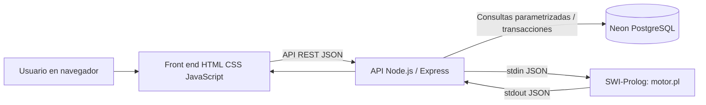

# Arquitectura del sistema

**Flujo de emisión:** navegador crea una factura pendiente → Express inicia una transacción → toma bloqueo de concurrencia → obtiene productos, clientes, kits y líneas de Neon → envía el contexto a SWI-Prolog → Prolog calcula impuestos, descuentos, stock y errores → Express persiste el resultado y, si es válido, actualiza stock y asigna consecutivo dentro de la misma transacción → responde al navegador.

**Importante:** Prolog es la única fuente de la lógica comercial; JavaScript no calcula IVA ni descuentos. Las reglas del motor corresponden a una simulación académica, no sustituyen la normativa fiscal vigente.

**Limitaciones:** un proceso SWI-Prolog por emisión añade latencia. Se usa bloqueo global advisory durante la emisión, idóneo para la escala del prototipo. El conjunto de usuarios carece de autenticación, por lo que el proyecto no debe publicarse como sistema comercial sin implementar identidad, autorizaciones, monitoreo y controles de seguridad adicionales.
